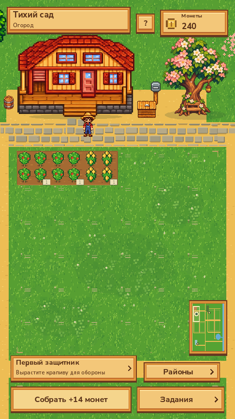
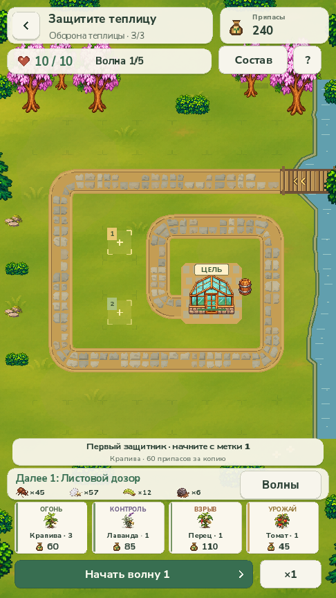

# Planta2 — Тихий сад

Уютная пиксельная ферма с боями **tower defense** на Godot. Выращивайте культуры, развивайте свой домашний сад и выводите растительных защитников на отдельные арены, чтобы остановить вредителей.

Начните со сбора трёх стартовых культур, посадите крапиву в питомнике и подготовьте первую оборону. Победа откроет водный сад и новые семена.

<p align="center">
  
  
</p>

## Что уже есть

- **Три места в общем саду:** огород у дома, питомник защитников и теплица улучшений. Карта 3600×2880 поддерживает перемещение и масштабирование.
- **Грядки квадратами 6×6:** по четыре квадрата и 144 настоящих посадочных места в огороде и питомнике; ещё 6 водных мест открываются после первой победы. У теплицы собственный двор оборудования.
- **Видимый рост:** незасаженные клетки покрыты луговой травой, обработанная почва появляется у настоящих посадок. У каждой посадки свои вид и уровень.
- **Развитие хозяйства:** сбор урожая, новые культуры, полив, компостер и хранение. Журнал сада и ближайшая цель помогают выбрать следующее действие.
- **Три боевые арены:** разные маршруты, волны вредителей, выбор выращенного состава и свободная расстановка с привязкой к клетке. Есть подсказки полезных позиций, роли растений, предпросмотр волн, пауза и скорость ×1/×2.
- **Две экономики:** постоянные монеты развивают сад, временные припасы оплачивают установки в бою. Поражение не разрушает сад и не отнимает уровни растений.
- **Сохранение прогресса:** растения, индивидуальные уровни, открытия, улучшения и текущая боевая сессия. Звуки действий отключаются в справке.

## Запуск

Проверено на **Godot 4.7.2 Standard**, GDScript, рендерер **Compatibility**. Проект рассчитан на вертикальный экран 540×960; сейчас это настольный игровой прототип.

1. Установите Godot Standard и откройте [project.godot](project.godot).
2. Дождитесь импорта ресурсов.
3. Нажмите **F5**, чтобы запустить проект.

На macOS можно воспользоваться [play.command](play.command). Если исполняемый файл Godot доступен как `godot` в `PATH`, запуск из корня репозитория:

```sh
godot --path .
```

## Управление

- **Сад:** нажатие на клетку или здание открывает действие. Перетаскивание перемещает карту; колесо мыши или жест двумя пальцами меняет масштаб. На клавиатуре доступны WASD и стрелки.
- **Навигация:** миникарта и кнопка «Районы» переводят к нужному месту; цветущее дерево открывает журнал развития.
- **Оборона:** выберите карточку растения и нажмите на свободную землю либо перетащите карточку на поле. Предпросмотр показывает допустимость позиции и радиус.
- **Пробел** запускает волну или переключает паузу; **Esc** закрывает текущую панель или возвращает назад. Подробности и выключатель звука находятся в «?».

## Проверки

После импорта ресурсов можно запускать независимые проверки из корня проекта:

```sh
godot --headless --path . --script tests/test_square_bed_state.gd
godot --headless --path . --script tests/test_square_bed_geometry.gd
godot --headless --path . --script tests/test_garden_experience.gd
godot --headless --path . --script tests/test_battle_redesign.gd
godot --headless --path . --script tests/test_battle_redesign_strategy.gd
godot --headless --path . --script tests/test_session_save.gd
```

Они проверяют миграцию сохранений, геометрию 6×6, реальные цели и посадки, боевые подсказки, прохождение трёх арен и продолжение сессии. Нативные сценарии захвата в `tests/capture_*.gd` дополнительно проверяют интерфейс, касания и кадры. Для сценариев сада используется отдельная копия сохранения. Подробные результаты и известное ограничение одной исторической боевой фикстуры описаны в [отчёте проверки](docs/first-impression-redesign-2026-11-06.md).

## Структура проекта

- [scripts/](scripts/) — состояние сада, кампания, боевой симулятор, ландшафт и интерфейс.
- [scenes/](scenes/) — главная сцена, сад и оборона.
- [assets/](assets/) — пиксельная графика, шрифты, промпты и описания ассетов.
- [tests/](tests/) — проверки правил, геометрии, сохранений и нативного интерфейса.
- [artifacts/](artifacts/) — игровые кадры для визуальной проверки.
- [docs/](docs/) — устройство игры, исследования и результаты художественных проходов.

## Исследования и история

- [Первое впечатление: выводы и реализованные изменения](docs/first-impression-redesign-2026-11-06.md).
- [20 фермерских и уютных ориентиров](docs/first-impression-farm-20-2026-11-06.md).
- [20 ориентиров для обороны](docs/first-impression-combat-20-2026-11-06.md).
- [Квадраты 6×6 и ландшафт](docs/square-beds-landscape-2026-11-06.md).
- [Предыдущие этапы разработки](docs/development-history.md).

Исследования отделяют наблюдения и официальные сведения от проектных гипотез. Подборки не являются универсальным рейтингом игр или доказательством роста удержания.

## Android и iOS

В [export_presets.cfg](export_presets.cfg) подготовлены мобильные пресеты. Это заготовки экспорта, а не готовые подписанные APK/IPA. Для сборки нужны совпадающие экспортные шаблоны Godot, Android SDK/JDK либо macOS/Xcode и настройка подписи iOS; проверки на настоящих устройствах остаются отдельным этапом.
